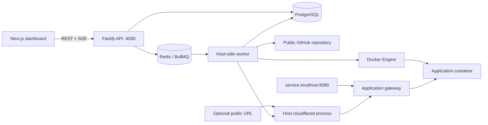

# DeployGrid

**From repository to running application.**

A self-hosted deployment dashboard for trusted public GitHub Node.js applications. DeployGrid builds real Docker images, verifies candidates before promotion, exposes stable local application URLs, restores retained releases, and monitors application health in the background.

The refreshed interface takes inspiration from service-oriented infrastructure dashboards: a searchable service table, status filters, grid/list views, service-specific navigation, deployment history, live terminal, resource charts, encrypted environment configuration, networking controls, and health history. It uses real application data throughout.

## What is implemented

- Asynchronous Git → Docker build → candidate → HTTP readiness → atomic promotion through a separate BullMQ worker.
- PostgreSQL project reservations and conditional state transitions prevent conflicting deployments and runtime operations.
- Stable URLs such as `http://my-api.localhost:8080` through the built-in application gateway. HTTP paths/query strings, streamed responses, and WebSocket upgrades are forwarded to the current deployment. The API/dashboard are separate loopback listeners.
- Encrypted, write-only runtime environment variables using AES-256-GCM. Deployments retain encrypted snapshots; historical rollback restores the selected release's original configuration. Values are injected at container creation, not into builds. Known literal values are redacted from persisted deployment output and returned runtime logs.
- Image-based rollback creates a new deployment attempt, checks retained-image ownership, starts a separate candidate and verifies readiness before changing the current release. No clone or rebuild is performed for rollback.
- Continuous worker-side HTTP/container health checks, failure threshold, recovery events and seven days of health samples. An intentionally stopped service is distinct from an unexpected exit.
- Optional public application sharing via a managed host-side cloudflared quick tunnel. Explicit confirmation is required; a public URL is displayed only after cloudflared reports a connected tunnel. Missing binaries and network failures are surfaced honestly.
- Safe redeployment, bounded logs, SSE reconnection/catch-up, actual Docker CPU/memory measurements, start/stop/restart and label-scoped project deletion.
- Independent temporary-directory cleanup and persisted Docker cleanup retries; a failed log write no longer skips filesystem cleanup or poisons subsequent log batches.
- Workspace activity feed and infrastructure diagnostics for PostgreSQL, Redis, Docker and worker heartbeat.

**This is a trusted, single-operator platform. It is not secure public multi-tenant hosting.** Public sharing exposes the selected deployed application only, not the deployment dashboard, API or Docker daemon.

## Architecture



The gateway resolves a project's current deployment from PostgreSQL for each request, so its stable hostname does not depend on Docker's dynamically allocated port. It listens on loopback and accepts only `<slug>.localhost` hosts. Quick tunnels set that Host header for their selected service.

## Monorepo

```text
apps/web                 Next.js / React / Tailwind / TanStack Query / Recharts
apps/api                 Fastify REST/SSE, platform routes, safe response serializers
apps/worker              BullMQ execution, recovery, health monitoring and tunnel supervision
packages/shared          Zod schemas, state transitions and errors
packages/database        Prisma 7 PostgreSQL adapter, schema and additive SQL migrations
packages/engine          Docker/Git orchestration, encryption, gateway, health and cleanup
examples/node-api        Dependency-free healthy deployment fixture
examples/broken          Deliberately failing Docker build
scripts                  Encryption-key setup and isolated integration/browser test harnesses
tests                    Unit, real API/database/Docker/gateway and Chromium browser tests
docs                     Architecture, lifecycle, decisions, limitations and verification
```

## Requirements

- Node.js **24 LTS** and pnpm **11.25.0**.
- Git and Docker Engine with Compose v2. Windows: Docker Desktop in **Linux container** mode.
- Ports **3000**, **4000**, **8080**, **5432**, and **6379** available locally.
- Optional public sharing: the cloudflared CLI installed on the same host as the worker.

Only local Docker hosts are supported: health checks and gateway forwarding assume Docker's published ports are reachable on this machine. No paid APIs or cloud accounts are needed. Internet access to GitHub, package/image registries and `binaries.prisma.sh` is required for relevant operations; dependency-installing Dockerfiles also need registry access and valid TLS trust inside their build environment.

## First startup — Windows PowerShell

Open a terminal in the extracted repository folder containing `package.json` and `compose.yaml`. Start Docker Desktop, then run:

```powershell
npm install --global pnpm@11.25.0
pnpm install --frozen-lockfile
Copy-Item .env.example .env
pnpm setup:key
pnpm db:generate
docker compose up -d --wait
pnpm db:migrate
pnpm dev
```

On Linux/macOS replace `Copy-Item .env.example .env` with `cp .env.example .env`. Open the dashboard at **http://127.0.0.1:3000** and keep the terminal running.

`pnpm setup:key` generates the encryption key without printing it; rerunning preserves an existing valid key. **Back up `.env` securely. Losing this key makes saved variables and deployment snapshots unreadable.** Never commit `.env` or replace the key while data encrypted with it is retained.

The API binds to 127.0.0.1:4000, the application gateway to 127.0.0.1:8080. PostgreSQL/Redis use Compose volumes. Stopping development processes leaves application containers and database volumes intact. The worker intentionally does not hot reload during long builds; restart after worker changes.

### Upgrading an existing installation

Stop `pnpm dev` with Ctrl+C. Keep your existing `.env` and Docker volumes. If you downloaded another ZIP, extract it into a new folder and copy your existing `.env` into that folder before starting. The Compose project name remains `deploygrid`, so its existing data volumes are reused.

```powershell
pnpm install --frozen-lockfile
pnpm setup:key
pnpm db:generate
docker compose up -d --wait
pnpm db:migrate
pnpm dev
```

The new migration adds configuration, health and sharing fields without removing existing projects or deployment history. Old deployments without an environment snapshot remain compatible.

### Production process startup

```powershell
pnpm build
pnpm start
```

This runs the built Next.js frontend plus the host API/worker through tsx. Backend build scripts perform strict compilation checks rather than creating separately bundled server artifacts. Root build/start/dev scripts load `.env`. For separate terminals:

```powershell
pnpm exec dotenv -e .env -- pnpm --filter @deploygrid/api dev
pnpm exec dotenv -e .env -- pnpm --filter @deploygrid/worker dev
pnpm exec dotenv -e .env -- pnpm --filter @deploygrid/web dev
```

## Deploy an application

1. Put the **contents** of `examples/node-api` in the root of a separate public GitHub repository, including its Dockerfile and `.dockerignore`, then commit/push it using your own Git credentials.
2. Create a service with the repository HTTPS URL, port **3000**, health path **/health** and a blank branch to use the repository default.
3. Under **Environment**, optionally add `GREETING=Hello from my service`. Values are write-only: replace them to edit; they cannot be revealed from storage.
4. Click **Deploy project**. Watch real logs, then open the stable `<slug>.localhost:8080` application URL.
5. Change `GREETING` and deploy again to apply it. A failed build/readiness check leaves the previous successful application available.
6. Under **Deployments**, use the rollback action beside a previous successful release. Confirm restoration. Its retained image and environment snapshot are verified before promotion.
7. **Health checks** shows actual background observations; **Application logs** and **Overview** show real container output and resource measurements.

The example uses `GREETING`, listens on 0.0.0.0 inside the container and exposes `/health`. `examples/broken/Dockerfile` deliberately fails during build for a reproducible failure demonstration.

Modern Chromium browsers resolve `.localhost` subdomains to loopback automatically. If your browser/OS does not, add a local hosts entry for the service hostname or use its direct container URL from Networking. Direct container ports can change; the gateway hostname remains stable.

## Public sharing

Windows installation:

```powershell
winget install --id Cloudflare.cloudflared --exact
```

Close/reopen the terminal afterward so the worker sees the updated PATH, then restart DeployGrid. Verify `cloudflared --version`. On other systems install the official cloudflared package using Cloudflare's instructions. An explicit executable path can be set with `CLOUDFLARED_PATH` in `.env`.

Deploy and start your service, open **Networking**, read/check the public-access confirmation, and choose **Enable public sharing**. The worker launches a real quick tunnel and displays its HTTPS URL only once it connects. Disable it from the same panel. Only the application gateway hostname for that service is targeted.

A quick tunnel needs outbound DNS and Cloudflare connectivity, has no uptime guarantee, and its URL changes after restart. Your machine, Docker, API/gateway and worker must stay running. This is a demonstration/sharing feature, not a promise of free permanent hosting. A public connection could not be verified in this cloud runner because its direct DNS requests are blocked; see verification evidence. No simulated public URL is used.

## Configuration

| Variable                                           | Default / purpose                                                         |
| -------------------------------------------------- | ------------------------------------------------------------------------- |
| DATABASE_URL                                       | Local PostgreSQL connection; keep in sync with Compose credentials        |
| REDIS_URL                                          | Local Redis/BullMQ connection                                             |
| DEPLOYGRID_ENCRYPTION_KEY                          | Generated by `pnpm setup:key`; 32 bytes as 64 hex characters              |
| API_PORT / API_URL                                 | 4000 / http://127.0.0.1:4000; rebuild frontend after changing API_URL     |
| WEB_ORIGIN                                         | http://localhost:3000; loopback aliases permitted for write-origin checks |
| GATEWAY_PORT                                       | 8080; restart API and worker together after changing                      |
| HEALTH_INTERVAL_MS                                 | 10000; time between completed background monitoring passes                |
| HEALTH_FAILURE_THRESHOLD                           | 3 consecutive failed checks before DEGRADED                               |
| HEALTH_TIMEOUT_MS                                  | 60000 initial candidate readiness deadline                                |
| BUILD_TIMEOUT_MS                                   | 600000                                                                    |
| WORKER_CONCURRENCY                                 | 1; run one worker process per queue                                       |
| CONTAINER_MEMORY / CONTAINER_CPUS / CONTAINER_PIDS | 512m / 1 / 128                                                            |
| CLOUDFLARED_PATH                                   | Optional host cloudflared executable path                                 |

Runtime variables are encrypted in PostgreSQL and passed to `docker create` using environment variable **names**, not values in CLI arguments. Host-process override names such as PATH, DOCKER_HOST, GIT_CONFIG_GLOBAL and NODE_OPTIONS are reserved. Variables are runtime-only; build-time secrets and Docker build arguments are intentionally not a feature.

The operator's host and Docker daemon remain trusted: Docker inspection can expose a container's environment. Literal redaction cannot hide arbitrary encoded/transformed output produced by application code. Avoid logging secrets in applications.

## API

All paths begin with `/api`. JSON errors use `{error:{code,message}}`. Created resources return 201, accepted jobs 202, invalid configuration 400, missing records 404, project conflicts 409 and infrastructure failures 503.

| Method             | Path                                 | Purpose                                                                |
| ------------------ | ------------------------------------ | ---------------------------------------------------------------------- |
| GET                | /health                              | PostgreSQL-backed API health                                           |
| GET                | /system                              | Database/Redis/Docker/worker diagnostics                               |
| GET                | /activity?before=eventId             | Recent operational events, 30 per page                                 |
| GET, POST          | /projects                            | List up to 100 services / create                                       |
| GET, PATCH, DELETE | /projects/:id                        | Read / edit idle service / delete with `{confirm:true}`                |
| POST, GET          | /projects/:id/deployments            | Accept deployment / history (`after` offset, `limit` ≤ 500)            |
| POST               | /projects/:id/rollback               | Accept new rollback attempt with `{deploymentId}`                      |
| GET                | /deployments/:id                     | Safe deployment metadata; no encrypted snapshot or host workspace path |
| GET                | /deployments/:id/logs                | Persisted events after an event ID, bounded pages                      |
| GET                | /deployments/:id/events              | SSE with Last-Event-ID / after cursor                                  |
| GET, PUT           | /projects/:id/environment            | Names/timestamps only / upsert `{name,value}`                          |
| DELETE             | /projects/:id/environment/:name      | Remove from future configuration                                       |
| GET                | /projects/:id/health-checks          | Recent actual observations (`limit` ≤ 200)                             |
| POST               | /projects/:id/sharing                | `{enabled,confirmPublic:true}` to enable, `{enabled:false}` to disable |
| POST               | /projects/:id/start, /stop, /restart | Serialized Docker lifecycle operations                                 |
| GET                | /projects/:id/metrics                | Read-only actual Docker measurements                                   |
| GET                | /projects/:id/runtime-logs           | Last 200 lines with known-value redaction                              |

PostgreSQL record creation and Redis enqueue are separate operations. A durable queued row survives enqueue failure; the worker restores missing jobs. A 202 response does not claim deployment success. Deployment success and ongoing runtime health are separate states.

## Tests

```powershell
pnpm typecheck
pnpm lint
pnpm test
pnpm test:integration
pnpm build
pnpm exec playwright install chromium
pnpm test:browser
```

Stop normal DeployGrid processes before browser tests: they reserve ports 3000/4000/8080. Browser tests create an isolated database/queue, start the production frontend and a test-only real worker, and use an actual committed local Git fixture for one explicitly identified repository URL. This clone substitution exists only in the guarded test harness; the production API and worker never accept local repository paths. Git, Docker, readiness, encryption, gateway, rollback and health remain real. No fake metrics/deployments populate a normal workspace.

Set `CHROMIUM_PATH` if using an existing browser. The database user needs local CREATE DATABASE permission. The test runner creates a unique temporary database/queue and removes its own resources; do not point tests at a remote database.

Optional external tests:

```powershell
# With normal pnpm dev running and your public example repository:
$env:E2E_REPOSITORY_URL="https://github.com/YOUR_NAME/YOUR_EXAMPLE"
pnpm test:browser:deploy
# With cloudflared installed and suitable outbound networking:
$env:RUN_PUBLIC_SHARING="1"
pnpm test:integration tests/public-sharing.integration.test.ts
```

The public-tunnel test is skipped in the default local suite; a skipped external test is not counted as a passing public connection. See [verification](docs/VERIFICATION.md) for commands actually run and limitations.

## Screenshots and documentation

Browser tests generate actual captures under `docs/screenshots/`, including the workspace, service metrics, health, networking and mobile layout. Failures shown are real, explicitly exercised failure cases. See [architecture](docs/ARCHITECTURE.md), [deployment lifecycle](docs/DEPLOYMENT-LIFECYCLE.md), [decisions](docs/DESIGN-DECISIONS.md) and [limitations](docs/LIMITATIONS.md).

Deferred: GitHub webhooks, deployment cancellation, persistent application volumes, retention controls, backups, remote-dashboard authentication, private repository credentials, custom public domains, stable named tunnels, multi-host orchestration and Kubernetes. The control plane remains private and the platform supports trusted code only.
