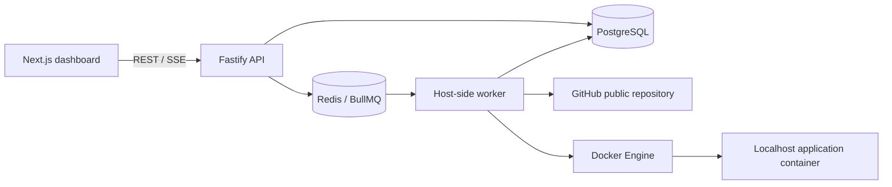

# DeployGrid

**From repository to running application.**

DeployGrid is a local deployment control plane for one trusted operator. Register a public GitHub Node.js application, queue a deployment, watch real Git/Docker output, and manage the resulting localhost container. It exists to make deployment infrastructure understandable without requiring a cloud account.

## Implemented

- PostgreSQL projects, immutable per-attempt configuration snapshots, commit metadata, deployment history, indexed persisted events.
- Atomic active-deployment reservations; short transactions; explicit conditional state transitions.
- Separate BullMQ worker performing Git clone, Docker build, constrained candidate startup, HTTP readiness and atomic promotion.
- Candidate failure cleanup; previous successful deployment preserved; interrupted attempt detection and queued-job reconciliation.
- Serialized asynchronous start/stop/restart and project deletion. Docker ownership labels scope every destructive action.
- REST API, cursor-based log history, SSE with persisted event IDs and browser reconnection, bounded runtime logs, actual Docker CPU/memory measurements.
- Responsive dark Next.js dashboard, project forms/settings, deployment terminal with follow/copy controls, runtime controls and live CPU chart.

No generated fake projects, deployments, logs or chart samples are included in the application. Browser tests create real temporary records and deployments.

## Architecture



The API never builds images inside a request handler. A database-backed reservation coordinates project changes; queue delivery is at least once. Deployment completion and application runtime status are separate concerns. See [architecture](docs/ARCHITECTURE.md), [lifecycle](docs/DEPLOYMENT-LIFECYCLE.md), [decisions](docs/DESIGN-DECISIONS.md), and [limitations](docs/LIMITATIONS.md).

## Repository

```text
apps/web        Next.js App Router dashboard, Tailwind, shadcn-style Radix button, Lucide, Recharts, TanStack Query
apps/api        Fastify REST/SSE server with Zod request validation
apps/worker     BullMQ consumer and periodic reconciliation
packages/shared Shared validation, state transitions and errors
packages/database Prisma schema, SQL migration and PostgreSQL adapter
packages/engine Git/Docker adapters, state persistence and orchestration
examples/node-api Dependency-free healthy Node.js deployment fixture
examples/broken Intentionally failing Docker build
scripts         Isolated integration-test database runner
tests           Unit, real database/Docker and Playwright tests
docs            Architecture, decisions, limitations and verification evidence
```

## Requirements

Node.js 24 LTS (24.19.0 used here), pnpm 11.25.0, Git, Docker Engine with Compose v2. Windows: use Docker Desktop with **Linux containers** and PowerShell; Linux/macOS: Docker Engine/Desktop. Run the API and worker on the same machine as Docker using its normal local socket/named pipe. Remote Docker hosts are unsupported: health checking assumes published ports are reachable on this machine.

Allow package registries, GitHub, Docker Hub and `binaries.prisma.sh` on restrictive networks. Keep TLS and checksum verification enabled. Registry access during a Docker build is also required by dependency-installing Dockerfiles. Standard proxy variables are forwarded as Docker's predefined proxy build arguments; the repository must configure appropriate certificate trust when using an intercepting proxy. Never disable certificate verification.

## Local setup (PowerShell, also valid command-by-command on macOS/Linux)

```powershell
npm install --global pnpm@11.25.0
pnpm install --frozen-lockfile
Copy-Item .env.example .env
# macOS/Linux equivalent: cp .env.example .env
pnpm db:generate
docker compose up -d --wait
pnpm db:migrate
pnpm dev
```

Open the dashboard on **localhost port 3000**. API defaults to loopback port 4000. `pnpm dev` runs all three host processes; stopping them leaves deployed applications and Compose data intact. The worker deliberately does not hot-reload during long builds; restart development processes after worker code changes. API source hot reload can disconnect SSE clients; EventSource reconnects.

Run individually, from the repository root in terminals that load `.env`:

```powershell
pnpm exec dotenv -e .env -- pnpm --filter @deploygrid/api dev
pnpm exec dotenv -e .env -- pnpm --filter @deploygrid/worker dev
pnpm exec dotenv -e .env -- pnpm --filter @deploygrid/web dev
```

Production compilation: `pnpm build`; launch all three processes with `pnpm start`. `pnpm --filter @deploygrid/web start` serves the built frontend; API/worker execute through `tsx` with the same commands. Backend build scripts run strict compilation checks; this MVP does not emit separate bundled server artifacts.

## Environment configuration

Copy `.env.example` without committing `.env`. It contains local development database credentials only; change them and the Compose values together for another installation. No paid service or API key is required.

| Variable | Default / purpose |
| --- | --- |
| DATABASE_URL | Local PostgreSQL connection |
| REDIS_URL | Local persistent BullMQ queue |
| API_PORT | 4000; loopback binding |
| WEB_ORIGIN | http://localhost:3000; write-origin allowlist |
| API_URL | http://127.0.0.1:4000; frontend proxy destination |
| BUILD_TIMEOUT_MS | 600000 |
| HEALTH_TIMEOUT_MS | 60000, per-request timeout up to 2 seconds |
| WORKER_CONCURRENCY | 1; increase only after capacity and concurrency testing |
| CONTAINER_MEMORY / CONTAINER_CPUS / CONTAINER_PIDS | 512m / 1 / 128 |

Restricted cloud workspace: use writable local caches, e.g. Bash `export PNPM_HOME=/workspace/.pnpm npm_config_store_dir=/workspace/.pnpm-store BUILDX_CONFIG=/workspace/.buildx`. These are environment-specific cache paths, not project requirements.

## Deploy the example

1. Create an empty **public** GitHub repository using GitHub's UI.
2. Copy the contents of `examples/node-api` into that repository root, including Dockerfile and `.dockerignore`.
3. Commit and push using your normal Git credentials. DeployGrid does not perform this push or need your token.
4. Create a project using its HTTPS GitHub URL, container port **3000**, health path **/health**, and a blank branch to follow the repository default.
5. Click Deploy; watch the terminal through cloning, building, starting and verifying. Open the actual displayed localhost port.
6. Commit an update and redeploy. The current application remains running until the new candidate passes readiness. Ports can change after redeployment or restart.
7. To test failure, commit the Dockerfile from `examples/broken`. Its explicit `process.exit(1)` must fail the build. The previous successful container must remain available.

Integration tests use an isolated temporary Git repository created from the example; only the clone boundary is redirected. Git, Docker, HTTP, PostgreSQL and runtime control operations remain real. No local filesystem path is accepted through the production API.

## API overview

All paths start with `/api`. JSON errors have `{error:{code,message}}`. Creation returns 201, asynchronous operations 202, invalid configuration 400, missing records 404, busy/unique conflicts 409, infrastructure failures 503.

| Method | Path | Behavior |
| --- | --- | --- |
| GET | /health | PostgreSQL availability |
| GET, POST | /projects | List up to 100 / create |
| GET, PATCH, DELETE | /projects/:id | Read, edit idle project, asynchronously remove owned resources (`{confirm:true}`) |
| POST, GET | /projects/:id/deployments | Queue attempt / history (`after` is offset, `limit` ≤ 500) |
| GET | /deployments/:id | Attempt metadata |
| GET | /deployments/:id/logs | Persisted events (`after` event ID, `limit` ≤ 500) |
| GET | /deployments/:id/events | SSE; `Last-Event-ID` header or `after` query cursor |
| POST | /projects/:id/start, /stop, /restart | Reserve and queue actual Docker operation |
| GET | /projects/:id/metrics | Actual Docker inspect/stats; refreshes observed runtime state |
| GET | /projects/:id/runtime-logs | Last 200 Docker log lines |

If Redis enqueue fails, the API retains the queued PostgreSQL record; the running worker reconciles missing queue entries every 10 seconds. A 202 response signifies a durable accepted attempt, not successful deployment. Runtime operations expose the reservation and report failures as runtime events on the current deployment.

## Testing

```powershell
pnpm typecheck
pnpm lint
pnpm test
pnpm test:integration
pnpm build
pnpm exec playwright install chromium
# With pnpm dev running in another terminal:
pnpm test:browser
# Optional real public-repository success scenario:
$env:E2E_REPOSITORY_URL="https://github.com/YOUR_NAME/YOUR_EXAMPLE"
pnpm test:browser:deploy
```

If Chromium is already installed, set `CHROMIUM_PATH` to its executable instead of downloading Playwright's browser. Linux example: `CHROMIUM_PATH=/usr/bin/chromium pnpm test:browser`.

`test:integration` creates a uniquely named temporary local PostgreSQL database, applies Prisma migrations, uses a unique BullMQ queue name and deletes its database afterward. The PostgreSQL user needs local CREATE DATABASE permission (the Compose user has it). Tests remove only their own labeled containers/images. Docker or database absence is a failure, not a simulated pass. Do not run multiple deployment workers against the same production queue while developing recovery code.

Browser dashboard tests exercise real invalid-input and failed-clone flows, settings, deletion and responsive layout. The optional public deployment test builds real remote code and requires its Dockerfile's network dependencies to be available. See [verification evidence](docs/VERIFICATION.md) for actual results and external failures.

## Screenshots

Run the browser tests to capture `docs/screenshots/dashboard.png`, `deployment.png` and `mobile.png`. Screenshots represent actual records and failures from that run; they are not proof that a public-repository deployment succeeded. The optional successful deployment scenario also captures the project view.

## Security boundary and future work

**Trusted code only. Single operator. Localhost only.** A repository Dockerfile can execute arbitrary build commands; the worker has Docker-daemon privileges. Limits and dropped capabilities do not make this safe for public multi-tenant hosting. Docker is never exposed over unauthenticated TCP, its socket is never mounted into application containers, and no global prune is used. Logs can contain sensitive application output. Do not expose the API or dashboard to the internet.

Deferred: authentication/organizations, private repository credentials, webhooks, billing, Kubernetes, multi-host orchestration, stable reverse-proxy URLs, autoscaling, HTTPS automation and advanced secrets. See limitations for recovery and retention boundaries.
